  

<table>
<tr>
<td width="72%" valign="middle">

**Camilo Caballero (`CabDevX`)** — *Full Stack Developer*  
Construyo productos digitales de principio a fin: interfaces limpias, APIs sólidas y analítica con Machine Learning lista para producción.  
`Next.js` · `React` · `Django` · `FastAPI` · `PostgreSQL` · `Docker` ⚡

</td>
<td align="center" width="28%" valign="middle">

 
 
 

</td>
</tr>
</table>

<table>
<tr>
<td align="center" width="30%" valign="middle">
  
</td>
<td width="70%" valign="middle">

**Enfoque & Filosofía ✦**  
⚡ **Full Stack** — Python (`Django`, `FastAPI`) + TypeScript (`React`, `Next.js`) y SQL. 
🧠 **Datos & ML** — Analítica clínica y modelos predictivos aplicados a problemas reales. 
⚽ **Mentalidad** — Disciplina, juego en equipo e iteración continua dentro y fuera del código.

</td>
</tr>
</table>

<table>
<tr>
<td width="40%" valign="top">

**✦ tech stack**  

  

 

</td>
<td width="60%" valign="top">

**✦ proyectos destacados**  
🏥 **[HealthAnalytics IPS](https://github.com/Camilo-JC/HealthAnalytics)** — Analítica clínica y ML en salud.  
`Django 5` `Next.js 14` `PostgreSQL` `Docker`  
 

---

🐂 **[Los Toreto](https://github.com/Camilo-JC/toretos)** — Gestión táctica PWA: ventas, fiados e inventario.  
`TypeScript` `React` `PWA` `JWT`  

---

🌱 **[EcoEnergy](https://github.com/Camilo-JC/ecoenergy)** — Simulador energético con ML *(Hackathon 2026)*.  
`Python` `Machine Learning` `JavaScript`  

---

🚗 **[Tecnicentro Los Carros](https://github.com/Camilo-JC/TecnicentroLosCarros)** — Gestión de taller automotriz y citas.  
`TypeScript` `Frontend`  

</td>
</tr>
</table>

<h3 align="center"><code>// github stats</code></h3>

  

<h3 align="center"><code>// builder activity</code></h3>

  

<h3 align="center"><code>// laberinto de contribuciones</code></h3>

  <picture>
    <source media="(prefers-color-scheme: dark)" srcset="https://cdn.jsdelivr.net/gh/Camilo-JC/Camilo-JC@output/pacman-contribution-graph-dark.svg">
    <source media="(prefers-color-scheme: light)" srcset="https://cdn.jsdelivr.net/gh/Camilo-JC/Camilo-JC@output/pacman-contribution-graph-dark.svg">
    
  </picture>

 

  

  ⚡ gracias por pasar — <a href="mailto:camilojc1725@gmail.com">hablemos</a>

