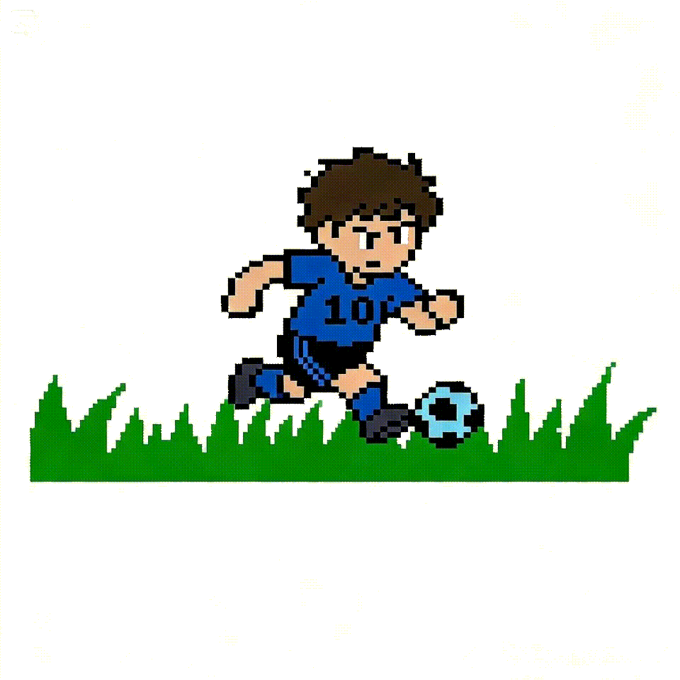
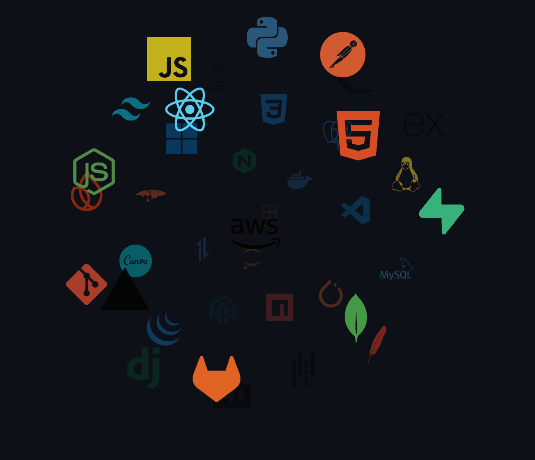

  

<table>
<tr>
<td width="70%" valign="top">

Soy **Camilo Caballero (`CabDevX`)**, Desarrollador de Software **Full Stack** enfocado en construir productos digitales completos — desde interfaces dinámicas hasta APIs eficientes.

Cuido la **arquitectura del código**, el diseño **UI/UX** y la integración de **datos y Machine Learning** para transformar ideas en aplicaciones listas para producción.

Actualmente profundizando en **Next.js, Django, FastAPI, PostgreSQL y Docker** para crear software cada vez más sólido. ⚡

</td>
<td align="center" width="30%" valign="middle">

 
 
 

</td>
</tr>
</table>

<table>
<tr>
<td align="center" width="35%" valign="middle">
  
</td>
<td width="65%" valign="top">

**Enfoque & Filosofía ✦**  
⚡ **Arquitectura Full Stack & Producto**  
Experiencia combinando ecosistemas de **Python (Django / FastAPI)** y **TypeScript (React / Next.js)** con bases de datos relacionales (**PostgreSQL / MySQL**) y contenedores **Docker**.  
🧠 **Datos & Machine Learning Aplicado**  
Construcción de plataformas con analítica clínica, tableros ejecutivos y modelos predictivos aplicados a necesidades reales (*HealthAnalytics IPS* y *EcoEnergy*).  
⚽ **Pasión por el juego**  
Dentro y fuera del código creo en la disciplina, el juego en equipo y la mejora continua en cada iteración.

</td>
</tr>
</table>

<table>
<tr>
<td width="40%" valign="top">

**✦ tech stack**  

  

 
**Enfoque actual** 
`Clean Architecture` `REST APIs` `PWA` `Machine Learning`

</td>
<td width="60%" valign="top">

**✦ proyectos destacados**  
🏥 **[HealthAnalytics IPS](https://github.com/Camilo-JC/HealthAnalytics)**  
Plataforma de gestión, analítica clínica y Machine Learning para datos de salud.  
`Django 5` `Next.js 14` `PostgreSQL` `Docker`  
 

---

🐂 **[Los Toreto](https://github.com/Camilo-JC/toretos)**  
Sistema de gestión táctica PWA para tiendas: dashboard financiero, fiados, inventario y reportes PDF.  
`TypeScript` `React` `PWA` `JWT`  

---

🌱 **[EcoEnergy](https://github.com/Camilo-JC/ecoenergy)**  
Simulador inteligente de consumo energético residencial impulsado por Machine Learning *(Hackathon 2026)*.  
`Python` `Machine Learning` `JavaScript`  

---

🚗 **[Tecnicentro Los Carros](https://github.com/Camilo-JC/TecnicentroLosCarros)**  
Plataforma integral para gestión de taller automotriz: clientes, vehículos, servicios y citas.  
`TypeScript` `Frontend`  

---

</td>
</tr>
</table>

<h3 align="center"><code>// github stats</code></h3>

  

<h3 align="center"><code>// builder activity</code></h3>

  

<h3 align="center"><code>// laberinto de contribuciones</code></h3>

  <picture>
    <source media="(prefers-color-scheme: dark)" srcset="https://cdn.jsdelivr.net/gh/Camilo-JC/Camilo-JC@output/pacman-contribution-graph-dark.svg">
    <source media="(prefers-color-scheme: light)" srcset="https://cdn.jsdelivr.net/gh/Camilo-JC/Camilo-JC@output/pacman-contribution-graph-dark.svg">
    
  </picture>

 

  

  ⚡ gracias por pasar — construyamos algo genial juntos — <a href="mailto:camilojc1725@gmail.com">hablemos</a>

